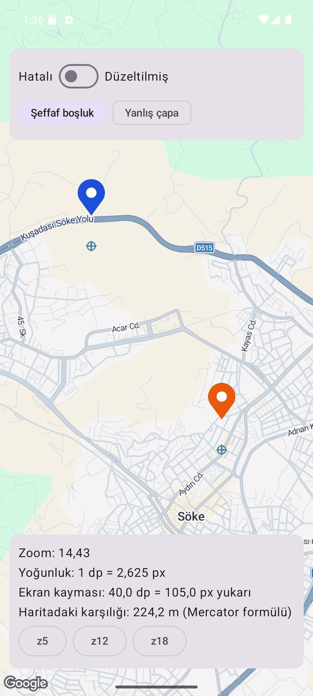
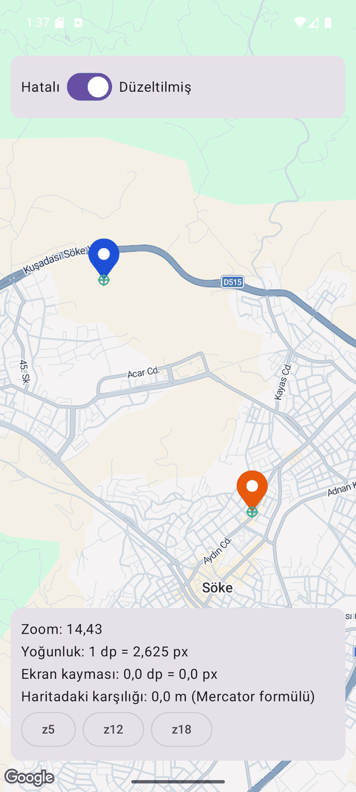
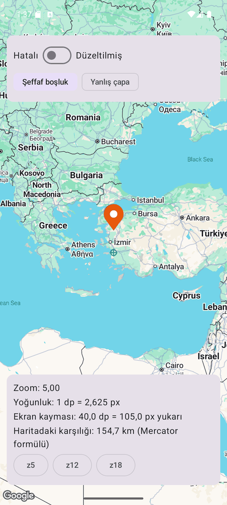
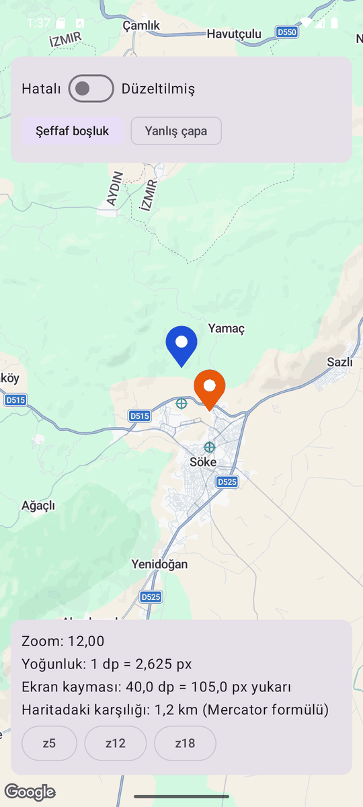
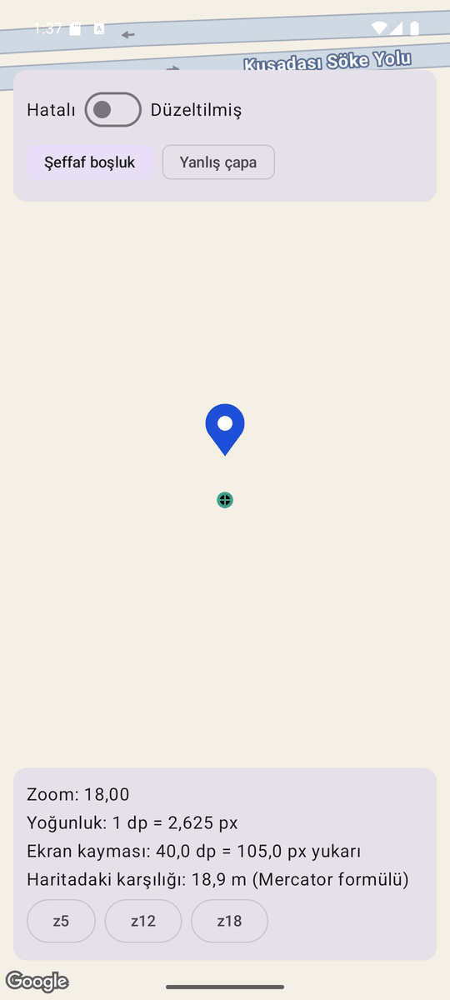
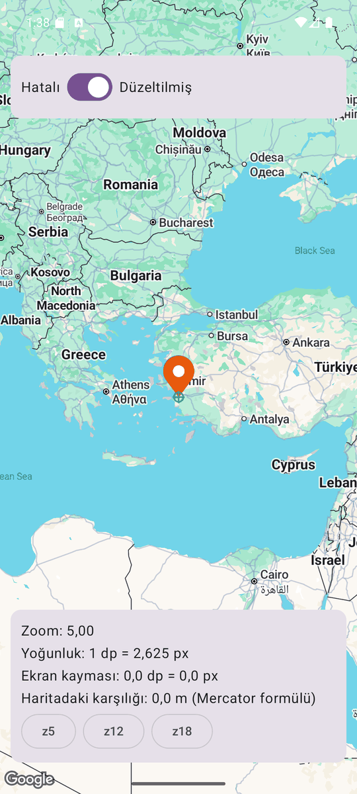
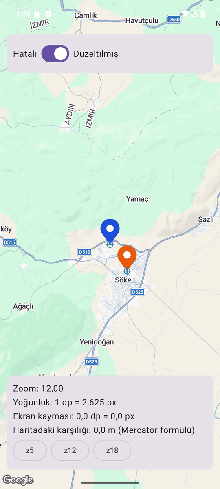
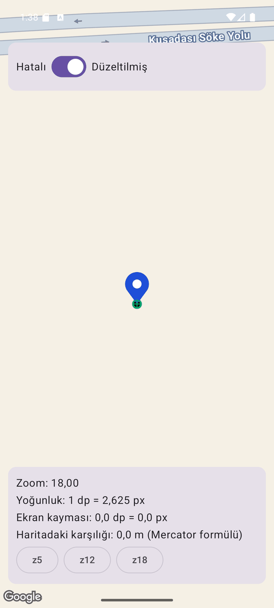
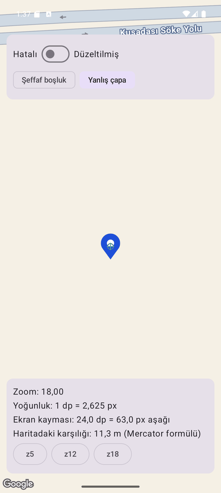

# Harita İşaretçisi Kayması (Marker Drift)

**Haritayı uzaklaştırınca işaretçiler neden kayıyor, yakınlaştırınca neden düzeliyor? Sebebini buldum, bilerek yeniden ürettim, ölçtüm ve çözümünü yazdım.**

> *English summary:* Map markers that look correct when zoomed in but drift away from their true location when zoomed out are usually drawn with a constant **screen-space** offset: the icon's anchor does not match the pin's tip, or the image has transparent padding. A constant offset in dp becomes a ground error that doubles with every zoom level out. This repo explains the cause, how to detect it and how to fix it, and includes an Android demo with screenshot-based tests across zoom levels and screen densities.

| Hatalı: pinlerin ucu gerçek noktada değil | Düzeltilmiş: uçlar tam gerçek noktada |
|---|---|
|  |  |

*Yeşil artılı halkalar işaretçilerin gerçek koordinatını gösteriyor. Mavi = ev (gizlilik için konumu birkaç yüz metre kaydırdım), turuncu = şube.*

---

## Nasıl başladı?
Bir yemek uygulamasında siparişimi haritadan takip ederken bir şey dikkatimi çekti. Benim konumum ve şubenin konumu yakın görünümde doğru yerdeydi, ama haritayı uzaklaştırdıkça ikisi de kayıyordu. Tekrar yakınlaştırınca düzeliyordu.

İlk bakışta "konum yanlış" gibi duruyor ama değil. Konum yanlış olsaydı her zoom'da aynı yerde yanlış görünürdü. Burada hata zoom'a göre büyüyüp küçülüyordu. Bu da bana sorunun koordinatta değil, işaretçinin ekrana nasıl çizildiğinde olduğunu düşündürdü.

O uygulamanın koduna bakmadım (bakamam da). O yüzden bu repo "o uygulamada hata kesin budur" demiyor. Bu belirtiyi birebir üretebilen bir mekanizmayı gösteriyor, ölçüyor ve nasıl düzeltileceğini anlatıyor. Bu tür bir sorunla karşılaşan herkesin işine yarasın diye genel tuttum.

## İçindekiler
1. [Neden oluyor?](#1-neden-oluyor)
2. [Tipik sebepler](#2-tipik-sebepler)
3. [Nasıl anlarsın?](#3-nasıl-anlarsın)
4. [Çözüm](#4-çözüm)
5. [Ekipler için kontrol listesi](#5-ekipler-için-kontrol-listesi)
6. [Demo uygulaması](#6-demo-uygulaması)
7. [Kurulum](#7-kurulum)
8. [Test sonuçları](#8-test-sonuçları)
9. [Sınırlar](#9-sınırlar)

---

## 1. Neden oluyor?
Haritadaki bir işaretçinin iki parçası var:

- **Konum** coğrafi: enlem ve boylam. Zoom değişince haritadaki yeri değişmiyor.
- **Simge** ekranda: dp/piksel cinsinden bir resim. Zoom ne olursa olsun ekranda aynı boyda kalıyor.

Bu ikisini **çapa (anchor)** birbirine bağlıyor. Çapa, "resmin hangi noktası koordinatın üstüne otursun" sorusunun cevabı. Değerleri 0 ile 1 arasında: `(0.5, 1.0)` alt-orta, `(0.5, 0.5)` tam orta demek.

Çapa ile pinin sivri ucu aynı noktada değilse, uç gerçek konumdan **ekranda hep aynı mesafede** çiziliyor:

```
  Doğru: çapa = uç               Hatalı: çapa ≠ uç

     ●●●                            ●●●
    ●   ●                          ●   ●
     ● ●                            ● ●
      ▼  ← uç = gerçek konum         ▼  ← uç (yanlış yerde)
                                     ┊  şeffaf boşluk
                                     ✕  ← çapa = gerçek konum
```

Asıl olay şu: ekrandaki bu sabit mesafenin haritada kaç metre ettiği zoom'a bağlı. Web Mercator'da:

    metre/dp = 156543.03 × cos(enlem) / 2^zoom
    hata (m) = ekrandaki kayma (dp) × metre/dp

Yani her zoom kademesinde hata ikiye katlanıyor ya da yarıya iniyor. Demodaki 40 dp'lik kayma için:

| Zoom | Haritadaki hata | Ne görüyorsun |
|---|---|---|
| 18 (sokak) | ~19 m | Aynı bina, fark etmezsin |
| 12 (şehir) | ~1,2 km | Bambaşka bir mahalle |
| 5 (ülke) | ~155 km | Bambaşka bir şehir |

Benim gördüğüm de tam buydu. Yakındayken hata birkaç metre olduğu için her şey doğru görünüyordu. Uzaklaştıkça harita küçüldü ama pin aynı boyda kaldı, ve aynı birkaç piksel kilometrelere karşılık gelmeye başladı. İşaretçi aslında hiç hareket etmiyordu; değişen, hatanın haritadaki anlamıydı.

**Birim notu:** Google Maps SDK for Android'de zoom 0'da dünya 256 **dp** genişliğinde. Formüldeki birim bu yüzden dp. Fiziksel piksel = dp × ekran yoğunluğu; örneğin 420 dpi'de 1 dp = 2,625 px.

## 2. Tipik sebepler
Araştırınca bunun çok yaygın bir hata olduğunu gördüm. Google Maps'e özgü değil; simgeyi ekranda çizen her harita kütüphanesinde olabiliyor.

**Ekranda sabit kayma yaratanlar:**

1. **Yanlış çapa:** Ucu altta olan pin simgesi merkez çapayla kullanılıyor.
2. **Görselde şeffaf boşluk:** Simge gölge, parlama veya hizalama payıyla dışa aktarılmış; ucun altında görünmez pikseller var.
3. **Layout'tan üretilen simge:** Pinin altına etiket, rozet veya margin eklenmiş bir view bitmap'e çevriliyor; uç artık resmin en altında değil.
4. **Vektör simgede boşluk:** SVG veya VectorDrawable'ın çizim alanı görünen şekilden büyük.
5. **Yoğunluk hatası:** Ofset elle, tek bir cihazın piksel değerine göre hesaplanmış.

**Kütüphanelerin varsayılanları birbirinden farklı.** Bir kütüphaneden diğerine geçerken bu hata kolayca ortaya çıkıyor. Aşağıdaki bilgileri ilgili dokümantasyonlardan aldım; ben sadece Google Maps SDK for Android'i test ettim.

| Kütüphane | Varsayılan çapa | Ayar |
|---|---|---|
| Google Maps SDK (Android) | alt-orta `(0.5, 1.0)` | `MarkerOptions.anchor(u, v)` |
| Mapbox (symbol layer) | merkez | `iconAnchor` / `icon-anchor` |
| Leaflet | `iconSize` verilip `iconAnchor` verilmezse merkez | `iconAnchor: [x, y]` (piksel) |
| Apple MapKit (`MKAnnotationView`) | merkez | `centerOffset` |

**Benzer görünen ama başka sebepler.** Belirtiyi doğru ayırt etmek önemli, çünkü çözümleri farklı:

| Belirti | Muhtemel sebep |
|---|---|
| Kayma **ekranda sabit**, metre olarak zoom'la büyüyor | Çapa veya görseldeki boşluk (bu repo) |
| Kayma **metre olarak sabit**, her zoom'da aynı yerde yanlış | Koordinatın kendisi yanlış: adres çözümleme, ondalık veya datum hatası |
| Belli zoom seviyelerinde **zıplıyor** | Kümeleme (clustering) veya çakışma önleme işaretçiyi taşıyor |
| Hareket ederken geride kalıyor | Animasyon veya interpolasyon |

## 3. Nasıl anlarsın?
1. **Bir referans noktası koy.** İşaretçinin gerçek koordinatına geçici olarak küçük, **merkezli** bir simge ekle (`anchor(0.5, 0.5)`). Merkezli simgede çapa hatası olamayacağı için güvenilir bir referans oluyor. Demodaki yeşil halkalar tam bunun için var.
2. **Zoom 5, 12 ve 18'de bak.** Pinin ucu referansta kalıyor mu?
3. **Ekrandaki mesafeyi ölç.** Kayma her zoom'da aynı piksel değerindeyse sebep çapa veya boşluk. Metre olarak sabitse koordinat hatası.
4. **Simge dosyasını aç.** Ucun altında şeffaf piksel var mı? Ucun görsel içindeki yeri (x, y) neresi?
5. **Bunu bir teste bağla.** Ben [`MarkerTipOnScreenTest`](app/src/androidTest/java/com/example/markerdrift/MarkerTipOnScreenTest.kt) ile pin ucunu ekran görüntüsünün piksellerinden bulup gerçek koordinatın ekrandaki yeriyle karşılaştırdım.

## 4. Çözüm
**Tek kural: çapa = görseldeki ucun konumu.**

```kotlin
// Ucu tam alt-ortada olan, boşluksuz pin
MarkerOptions()
    .position(latLng)
    .icon(pinIcon)
    .anchor(0.5f, 1.0f)

// Merkezli simge (nokta, daire, araç ikonu)
    .anchor(0.5f, 0.5f)
```

**Görselde boşluk varsa:**
- **En temizi:** Görseli kırpıp boşluğu atmak.
- **Görsele dokunamıyorsan:** Çapayı ucun yerinden hesapla. Oran olduğu için ekran yoğunluğundan bağımsız çalışır:
  ```kotlin
  // Örnek: 88 birim yüksekliğinde görsel, uç 48. birimde
  val anchorU = tipX / bitmapWidth.toFloat()
  val anchorV = tipY / bitmapHeight.toFloat()   // 48 / 88 = 0.545
  MarkerOptions().anchor(anchorU, anchorV)
  ```

**Layout'tan üretilen simgelerde** ucun yerini layout'tan ölçüp aynı hesabı kullan, ya da etiketi işaretçiden ayır.

## 5. Ekipler için kontrol listesi
- [ ] Her işaretçi simgesi, uç noktasının bilgisiyle birlikte tanımlanıyor (simge + çapa bir "sözleşme").
- [ ] Tasarımcılar pinleri ucu alt kenara değecek şekilde, gölgesiz veya boşluksuz dışa aktarıyor. Ya da ucun yerini belgeliyor.
- [ ] Simge değişince çapa da gözden geçiriliyor.
- [ ] Ekran görüntüsü testi farklı zoom seviyelerinde ve en az iki ekran yoğunluğunda ucun yerini kontrol ediyor.
- [ ] Yoğunluğa göre ayrı PNG'ler yerine tek bir vektör simge kullanılıyor.
- [ ] *(İsteğe bağlı)* Şehir veya ülke ölçeğinde pin yerine merkezli küçük bir nokta gösteriliyor. Çapa hatası olamaz, kalabalık görünümde de daha okunaklı.
- [ ] Hata raporlarında cihaz modeli, ekran yoğunluğu, uygulama sürümü ve ekran kaydı isteniyor.

---

## 6. Demo uygulaması
Sorunu kendim görmek için Kotlin ile küçük bir Android uygulaması yazdım. Google Maps SDK for Android kullandım, ama bu sadece demo için yaptığım bir seçim; sorun herhangi bir harita kütüphanesine özgü değil.

Uygulamada şunlar var:
- İki işaretçi (ev ve şube)
- Gerçek konumlarını gösteren yeşil referans halkaları
- **Hatalı / Düzeltilmiş** anahtarı
- Güncel zoom'u ve kaymanın haritadaki karşılığını gösteren bilgi paneli

**Modlar:**
- **Hatalı: şeffaf boşluk.** Pinin altına 40 dp şeffaf dolgu koydum ve varsayılan `anchor(0.5, 1.0)` ile kullandım. Uç, gerçek konumun 40 dp **yukarısında** çiziliyor.
- **Hatalı: yanlış çapa.** Ucu altta olan 48 dp'lik pini `anchor(0.5, 0.5)` ile kullandım. Uç, gerçek konumun 24 dp **aşağısında** çiziliyor.
- **Düzeltilmiş.** Boşluksuz pin, `anchor(0.5, 1.0)`.

| Dosya | Ne yapıyor |
|---|---|
| `geo/MercatorMath.kt` | metre/dp, kayma → metre, px ↔ dp, haversine |
| `marker/MarkerMode.kt` | Modlar → görsel boyutu, çapa, uç konumu |
| `marker/PinIcon.kt` | Kodla çizilen pin ve referans halkası |
| `ui/MapScreen.kt` | Harita, işaretçiler, referans halkaları, anahtar, bilgi paneli |
| `ui/Place.kt` | Örnek konumlar; isteğe bağlı yerel konum dosyasının okunması |
| `res/raw/map_style.json` | İşletme/POI ve toplu taşıma etiketlerini gizliyor, ekran görüntülerinde işletme veya kişi adı çıkmasın diye |

### Öncesi / sonrası
Pixel 7 emülatörü, 420 dpi. Mavi pin ev (gizlilik için birkaç yüz metre kaydırdım), turuncu pin şube.

| | z5 | z12 | z18 |
|---|---|---|---|
| **Hatalı: şeffaf boşluk** |  |  |  |
| **Düzeltilmiş** |  |  |  |

En çok z12'yi seviyorum: hatalı modda turuncu şube pini, evin gerçek noktasının hemen yanında duruyor. Yani kullanıcının gözünde iki konum birbirine karışıyor. Düzeltilmiş modda iki pinin ucu da kendi halkasının tam üstünde.

Hatalı: yanlış çapa, z18 (uç gerçek noktanın altında kalıyor):



## 7. Kurulum

### Gerekenler
- Android Studio (SDK, Emulator, Platform-Tools ile). Sürümler `gradle/libs.versions.toml` içinde.
- JDK 17 veya üstü (ben JDK 21 kullandım)
- Google Play hizmetli bir emülatör veya Android 7.0+ (API 24+) telefon
- Kendi Google Maps API anahtarın. Google Cloud faturalandırma isteyebilir, güncel koşullara bak.

### API anahtarı
Kurulumu [Maps SDK for Android resmi dokümanına](https://developers.google.com/maps/documentation/android-sdk/config) göre yaptım. Anahtar, [Secrets Gradle Plugin](https://developers.google.com/maps/documentation/android-sdk/secrets-gradle-plugin) ile git'e girmeyen `secrets.properties` dosyasından okunuyor.

1. Google Cloud'da bir proje oluştur, faturalandırmayı bağla ve **Maps SDK for Android**'i etkinleştir.
2. **APIs & Services → Credentials → Create credentials → API key** ile bir anahtar oluştur.
3. Anahtarı kısıtla:
   - Uygulama: **Android apps**, paket adı `com.example.markerdrift` ve kendi SHA-1'in:
     ```
     keytool -list -v -keystore %USERPROFILE%\.android\debug.keystore -alias androiddebugkey -storepass android -keypass android
     ```
   - API: sadece **Maps SDK for Android**
4. Proje kökünde `secrets.properties` dosyasını oluştur:
   ```
   MAPS_API_KEY=anahtarın
   ```
   `local.defaults.properties` sadece `DEFAULT_API_KEY` yer tutucusunu içeriyor. Anahtar yoksa uygulama derleniyor ama harita çizilmiyor.

### Kendi konumların (isteğe bağlı, git'e girmez)
Örnek koordinatlar yerine kendi konumlarını görmek istersen proje kökünde `local.places.properties` dosyasını oluştur. Bu dosya `.gitignore`'da:
```
PLACE_A_NAME=Ev
PLACE_A_LAT=...
PLACE_A_LNG=...
PLACE_B_NAME=Şube
PLACE_B_LAT=...
PLACE_B_LNG=...
```
Dosya yoksa veya bir değer geçersizse örnek koordinatlar kullanılıyor. Dosya varsa kamera iki noktayı birden gösterecek şekilde açılıyor. Ben de README görüntülerini böyle aldım: şube gerçek konumunda, evi ise kaydırarak yazdım. Testler her zaman örnek koordinatları kullanıyor.

### Derleme ve test
```
gradlew assembleDebug                 # APK
gradlew testDebugUnitTest             # JVM birim testleri
gradlew installDebug installDebugAndroidTest
adb shell am instrument -w -r com.example.markerdrift.test/androidx.test.runner.AndroidJUnitRunner
```
Enstrümantasyon testlerini `connectedDebugAndroidTest` yerine doğrudan `am instrument` ile çalıştırdım. Gradle'ın test aracı ilk testten sonra emülatörle bağlantıyı kaybedip ("Broken pipe") test APK'sını siliyordu.

## 8. Test sonuçları
Tarih: 2026-11-26. Sadece burada yazanları çalıştırdım. Testler örnek koordinatlarla (37.8450, 27.8400) koşuyor.

### Birim testleri (JVM): 22/22 geçti
- `MercatorMathTest` (11): 98 dp ve 37.845° örneği (z18 ≈ 46,2 m, z12 ≈ 2957 m, z5 ≈ 378,5 km), zoom başına yarılanma, kesirli zoom, px↔dp, haversine
- `MarkerModeTest` (5): her modun çapası ve beklenen uç ofseti
- `LocalPlacesTest` (6): yerel konum dosyasının okunması; eksik, geçersiz ve aralık dışı değerler

### Enstrümantasyon testi: `MarkerTipOnScreenTest`
Uygulamanın kendi hesabına güvenmek istemedim. Bu test pin ucunu **ekran görüntüsünün piksellerinden** buluyor (pin rengine uyan en alt satır) ve gerçek koordinatın harita projeksiyonuyla bulunan ekrandaki yeriyle karşılaştırıyor. Üç mod × z5/z12/z18 = 9 test. Tolerans ±4 px.

| Cihaz (emülatör, API 36) | Yoğunluk | Sonuç |
|---|---|---|
| Pixel 7 | 420 dpi (1 dp = 2,625 px) | **9/9 geçti** |
| Pixel 4a | 440 dpi (1 dp = 2,75 px) | **9/9 geçti** |
| Pixel 4a, `wm density 280` geçersiz kılma | 280 dpi (1 dp = 1,75 px) | **9/9 geçti** |

Ölçülen dikey sapma (uç − gerçek konum, px; + = aşağı). Üç zoom'da da aynı değer çıktı (tek istisna: Pixel 4a/440'ta yanlış çapa z18 = +65):

| Mod | Pixel 7 · 420 | Pixel 4a · 440 | Pixel 4a · 280 | Beklenen (420 / 440 / 280) |
|---|---|---|---|---|
| Düzeltilmiş | −2 | −2 (z5: −1) | −2 (z5: −1) | 0 / 0 / 0 |
| Hatalı: şeffaf boşluk | −107 | −112 | −72 | −105 / −110 / −70 |
| Hatalı: yanlış çapa | +61 | +64 | +41 | +63 / +66 / +42 |

Yatay sapma her ölçümde −1 px.

**Bundan ne çıkıyor:**
- Kayma piksel olarak zoom'dan bağımsız ve ekran yoğunluğuyla orantılı. dp cinsinden üç cihazda da aynı (≈ 40,8 ve ≈ 23,3 dp). Hipotezimle birebir uyuyor.
- Ölçümler her modda 1–2 px yukarıda çıkıyor. Bunun sebebi pinin sivri ucundaki kenar yumuşatma: en alttaki soluk pikseller renk eşiğine takılmıyor. Yani bu uygulamadaki bir kayma değil, benim ölçüm yöntemimin küçük bir sapması.
- Pixel 4a emülatöründeki eski Play hizmetleri sürümünde, manifest'e `org.apache.http.legacy` ekleyene kadar harita çöküyordu. Bu, Maps SDK dokümanında yazan bir gereksinim; ancak ikinci cihazda test edince ortaya çıktı.

## 9. Sınırlar
Dürüst olmak gerekirse:
- **Sadece emülatörde test ettim, gerçek telefonda denemedim.** 280 dpi de gerçek bir cihaz değil, yoğunluk ayarını değiştirerek elde ettiğim bir değer.
- Sadece Google Maps SDK for Android'i test ettim. Diğer kütüphaneler hakkında yazdıklarım onların dokümantasyonlarından.
- Bu bağımsız bir öğrenci çalışması, hiçbir şirketle bağlantım yok. Gözlemlediğim uygulamanın kaynak koduna bakmadım, APK'sını açmadım, sunucu trafiğini izlemedim. Bu demo belirtiyi üretebilen **bir mekanizmayı** gösteriyor; o uygulamadaki gerçek sebebi **doğrulamıyor**.
- Kodu ve bu README'yi Claude Code (yapay zekâ asistanı) ile birlikte geliştirdim. Kararları ve kontrolleri ben verdim, ölçümler gerçekten çalıştırılan testlerden.

### Kendime koyduğum kurallar
- Sadece kendi kodum ve kendi çizdiğim görseller; başka bir şirketin kodu, logosu, simgesi veya API anahtarı yok.
- Kişisel adres yok. Ev konumunu görüntülerde kaydırdım; kendi konumlarım ve API anahtarım git'e girmeyen dosyalarda duruyor.
- Test etmediğim hiçbir şeyi "doğrulandı" diye yazmadım.

## Lisans
[MIT](LICENSE)
